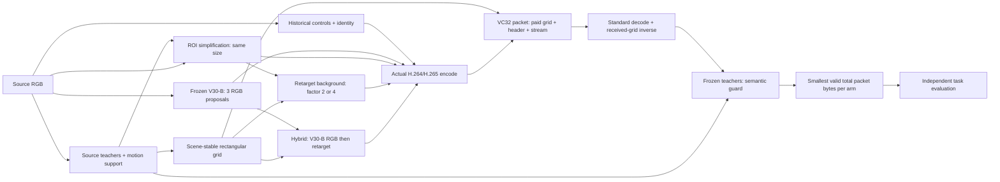

# V32: ROI simplification + retargeting

V32 bổ sung ý tưởng của bài [Video coding for machines using region-of-interest-based retargeting](https://link.springer.com/article/10.1186/s13640-025-00682-3) vào pipeline V30-B. Đây là bản thích nghi cho H.264/H.265 và nguồn AR128/OD320, không phải bản tái lập bit-exact VVC/VCM-RS của bài báo. Mã V30/V31 được giữ trong checkout riêng; module mới nằm ở `adaptive_vcm/v32`.

## Các khối và đường dữ liệu



Đường **clean source** là dự đoán của teacher trên RGB gốc. Nó đi vào guard để đo độ suy giảm sau codec. Identity cũng được encode/decode ở cùng codec/QP và làm mốc suy giảm. Teacher chấm ảnh đã inverse-retarget; teacher không chấm ảnh bị ép hình học trực tiếp. Nhãn thật chỉ đi vào khối đánh giá cuối.

**ROI simplification** giữ kích thước gốc: tích lũy ROI theo đoạn không cắt cảnh, bao vùng quan trọng bằng bbox có margin 5%, low-pass vùng closure và đưa nền ngoài về xám128. Hai strength .5/1 dùng blend `(1-P)*(1-.75M)`; pixel P=1 được khôi phục chính xác trước encode. P mềm vẫn cho phép lọc một phần. FIR25 cutoff .1 và closure tương đối theo kích thước là lựa chọn của V32; bài báo dùng bandwidth .01 và các tham số ảnh lớn khác.

**Retargeting** giảm kích thước ảnh mã hóa: các khoảng trục đi qua ROI giữ scale1, nền chia2/4. Grid cố định trong mỗi đoạn; các đoạn dùng chung kích thước coded lớn nhất, làm tròn chẵn. Phần kích thước bổ sung chỉ phân phối vào nền, giữ nguyên số mẫu ROI. Decoder dùng tọa độ truyền trong packet để kéo về hình học nguồn. Nén mất mát vẫn có thể thay đổi pixel ROI, nên semantic guard vẫn cần thiết. Nếu ROI rỗng hoặc không giảm được kích thước, bỏ ứng viên retarget.

**Hybrid** dùng RGB do checkpoint V30-B tạo ra rồi mới retarget; nó không thay filter bank hay huấn luyện lại. Không cung cấp checkpoint thì run ghi rõ `fixed_roi_only`, không có nhánh learned/hybrid.

## Các nhánh so sánh

| Arm | Pool ứng viên |
|---|---|
| anchor | Identity encode/decode |
| controls | Historical controls, gồm identity |
| v30b | Controls + 3 proposal của frozen V30-B |
| simplification | Controls + ROI strength .5/1 |
| retarget | Controls + fixed simplification strength1 rồi retarget factor2/4 |
| hybrid | Controls + 3 proposal V30-B + 6 proposal retarget của chúng |
| v32 | Hợp tất cả pool ở trên |

Mỗi arm chọn luồng nhỏ nhất qua cùng guard AR .1 / OD .03, giữ quyết định anchor theo giao thức gốc và tiết kiệm ít nhất1% tổng byte so với identity. Đây là selector thử nhiều ứng viên, không phải ngân sách K3 cho toàn bộ V32. Audit ghi toàn bộ encode/decode/teacher calls và thời gian thực. Nhánh `v30b` dùng cùng overhead VC32 nên không so trực tiếp số byte với báo cáo lịch sử chỉ có elementary stream.

## Packet và byte

VC32 có header40 byte gồm magic/version, task/codec/mode, geometry nguồn/coded, frame count, FPS rational, số đoạn, metadata/stream length và CRC32. Mỗi đoạn thêm8 byte và các trục source/coded uint16. Receiver xác thực chiều, coverage, thứ tự trục, CRC và độ dài rồi gọi FFmpeg chuẩn. Header chung được tính cho identity và controls. CRC phát hiện lỗi dữ liệu; nó không xác thực người gửi.

`coded_bytes = elementary_bytes + metadata_bytes`, trong đó `metadata_bytes` gồm cả header. Selection và BD-rate dùng `coded_bytes`. Bpp luôn chia cho số pixel nguồn canonical `T*H*W`, không chia cho kích thước retarget nhỏ hơn. Không truyền mask nguồn như một side channel miễn phí.

## Backpropagation trong V32

V32 này là mở rộng bằng phép biến đổi cố định và checkpoint frozen. **Không có bước backward, STE hay Adam mới.** Bank20 profile của V30-B vẫn là công thức cố định dùng tạo target offline khi huấn luyện checkpoint gốc. Gradient V30-B khi train chỉ đi qua RGB blend và các head gate/expert/strength về CNN; không đi xuyên codec thật hay teacher. Thay bank để train lại sẽ cần đo target mới trên TRAIN; việc đó chưa thuộc bản V32 này.

## Chạy

Từ checkout `D:/STUDY/LAB/bao_1/adaptive_v32_build`, dùng Python có torch/torchvision, OpenCV, scipy, pycocotools và FFmpeg. Trên máy này:

```powershell
$env:TEMP='D:\STUDY\LAB\bao_1\output\v32_tests\runtime_tmp'
$env:TMP=$env:TEMP
& D:/STUDY/AI/envs/ten_env/python.exe -m adaptive_vcm.v32.smoke --out ../output/v32_transport_smoke
```

Smoke tạo nguồn tổng hợp, chạy cả codec, lưu6 packet và decode lại từ bytes. Nó chỉ kiểm tra transport; không dùng để kết luận task accuracy hoặc BD-rate.

Đánh giá OD fixed-only:

```powershell
python -m adaptive_vcm.v32.evaluate --task od --root <COCO-images> --annotations <instances.json> --count 32 --split dev --out outputs/v32-od-dev32
```

Đánh giá AR với frozen V30-B:

```powershell
python -m adaptive_vcm.v32.evaluate --task ar --root <Kinetics-directory> --count 32 --split dev --checkpoint <v30-b-ar-preprocessor_last.pth> --v30-runtime ../adaptive_v30_build --out outputs/v32-ar-dev32
```

OD có thể dùng cùng hai option checkpoint/runtime, với checkpoint OD. Loader gốc phải xác thực code/commit/config/TRAIN đúng như lúc train. Không sửa checkpoint để vượt kiểm tra. V32 từ chối nguồn có ID hoặc pixel hash thuộc TRAIN của checkpoint. Chuẩn bị weights bằng cache đã có (ví dụ đặt `TORCH_HOME` vào `../output/v30b_by_category_20261008/torch_cache`). Lưới cấu hình cố định gồm QP30/35/40/45/50 và cả hai codec. `--bootstrap 0` dùng cho kiểm tra chạy nhỏ; mặc định2000 để báo CI.

Receiver độc lập, chỉ có file packet:

```powershell
python -m adaptive_vcm.v32.smoke --decode-packet ../output/v32_transport_smoke/h265-roi_retarget.v32 --out outputs/v32-received
```

## Đầu ra và giới hạn

`manifest.json`: hash source/code/config/checkpoint, ID/split, analyzer roles, status running/complete. `rows.jsonl`: từng arm/codec/QP, total/elementary/metadata byte, bpp, kết quả evaluator, packet path/hash. `selection_audit.jsonl`: toàn bộ ứng viên, khoảng cách guard, quyết định, số probe, support/cut metadata. `packets/`: packet thực được chọn. `summary.json`: từng codec/arm, đường rate-quality, cubic/PCHIP BD-rate, paired source bootstrap CI và chẩn đoán từng QP.

Từ chối thư mục output không rỗng và lưới thiếu/trùng. Curve không có quality overlap hoặc quality phẳng trả BD-rate không xác định; không ngoại suy. `target_confirmed=false` luôn giữ cho nghiên cứu mở rộng này. Chưa có kết quả benchmark V32 trên dữ liệu thật. Lợi ích detection/tracking trong bài báo không bảo đảm lợi ích AR hay nguồn128/320 của V32.
