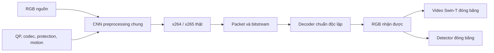

# V33-AP: adaptive preprocessing dùng chung cho OD và AR

Ngày: 2026-10-10. Trạng thái: người dùng đã duyệt văn bản bằng yêu cầu tiếp tục triển khai; chuyển sang lập kế hoạch.

## Mục tiêu và quyết định đã thống nhất

Người dùng yêu cầu giữ adaptive preprocessing trước codec chuẩn, bỏ NeRV, triển khai OD + AR và cho phép dùng nhiều tài khoản Kaggle. Thiết kế trong chat đã được chấp thuận bằng yêu cầu triển khai. Bản này cụ thể hóa thiết kế đó để duyệt trước khi lập kế hoạch và sửa mã, theo Superpowers brainstorming.

Mục tiêu là kiểm tra một CNN preprocessing học từ cả hai tác vụ có giữ chất lượng tác vụ ở bitrate thấp hơn so với identity và cùng kiến trúc chỉ học một tác vụ hay không. Thành công về triển khai nghĩa là có mã được kiểm chứng, checkpoint và payload có provenance, các notebook được Kaggle nhận. Hiệu quả BD-rate là kết quả thí nghiệm, không phải điều kiện có thể giả định trước khi chạy.

Tên campaign mới: `v33ap`. Các task là `ar` và `od`. AR là phân loại cả clip; OD là phát hiện đối tượng trên frame. Đây là tối ưu preprocessing theo nhiều tác vụ, không phải tái hiện detector object–action ICCV 2017. Không thêm NeRV, tracking, action theo từng track, task backbone mới hay mạng phục hồi RGB sau decoder. Giữ các experiment V32 và job AR/OT đã gửi làm bằng chứng lịch sử.

## Đường xử lý

CNN tạo RGB cùng hình dạng đầu vào. Clip được encode/decode một lần cho mỗi arm/codec/QP; khi yêu cầu cả hai task, Swin đọc clip và detector đọc các frame từ đúng reconstruction đó. Receiver nhận packet/decoded RGB, không nhận nguồn sạch, support của encoder, teacher targets hay ground truth. Cả hai đầu có cùng packet hash; byte được tính một lần.

COCO chỉ cung cấp một frame và nhãn OD. Không nhân bản ảnh COCO để tạo clip AR, không báo AR accuracy trên COCO. Clip Kinetics cung cấp nhãn AR và có thể có đầu ra OD phụ trợ nhưng không có OD mAP thật trên những clip này. Báo cáo hai benchmark riêng và một kiểm tra chạy hai đầu trên cùng packet; không tuyên bố có bộ test gán nhãn cả hai task trên cùng video.

## CNN dùng chung

Thêm module mới `adaptive_vcm/v33ap`; không đổi loader, schema hay provenance của checkpoint V32.

Một `JointPreprocessor` nhận `video` B×3×T×H×W, QP, codec ID, protection, motion và scene cuts. Kiến trúc kế thừa residual CNN V32-VC: hai Conv2d 3×3 với width12 và SiLU, một depthwise Conv3d (3,1,1) nhân hệ số0.1 cho clip T>1, một Conv2d 1×1 ra RGB. Temporal convolution dùng padding trái và reset ở scene cut; T=1 bỏ qua nhánh temporal. Không có task-specific output head hoặc task ID. Cùng tensor trọng số dùng cho cả AR và OD.

Head RGB khởi tạo zero, do đó đầu ra ban đầu bằng identity. Residual giới hạn bằng `0.1*tanh`, nhân `(1-protection)*(1-0.75*motion)`, cộng nguồn và clamp về[0,1]. Pixel protection=1 phải giữ chính xác. Model kiểm tra tensor hữu hạn, QP[0,51], codec0/1, shape và scene cuts hợp lệ. Không nạp hay sửa checkpoint lịch sử để làm warm start.

Protection và motion lấy từ nguồn sạch tại encoder bằng các phương thức sẵn có. Trên clip AR, protection hợp nhất saliency AR và box OD dự đoán tại các frame được lấy mẫu; box đó không phải GT. Trên COCO, protection dùng box OD dự đoán. Cả ba arm dùng cùng support đã cache để phép ablation chỉ thay loss, không thay vùng được phép sửa.

## Tác vụ, dữ liệu và phân chia

AR: dataset Kaggle `qktttttttttt/kineticscleaned`, mapping thư mục sang đúng400 lớp torchvision. Teacher và evaluator chính là `swin3d_t`, `Swin3D_T_Weights.KINETICS400_V1`, transform chính thức. R3D-18 và R(2+1)D-18 là evaluator phụ, chỉ scoring và semantic diagnostics. Không cập nhật trọng số, BatchNorm hay dropout của task models.

OD: dataset Kaggle `awsaf49/coco-2017-dataset`. Teacher là Faster R-CNN MobileNet FPN sẵn có để hạn chế chi phí train; evaluator là Faster R-CNN ResNet50 FPN sẵn có. COCO class IDs và tọa độ box phải theo đúng transform/inverse hiện có. Không đổi sang DETR: việc thay task backbone không cần thiết cho mục tiêu preprocessing và sẽ làm mất đối chứng với thí nghiệm cũ.

Mỗi task lấy64 nguồn TRAIN theo ordering/partition ổn định hiện có; chia FIT48, CAL12, PROXYVAL4 bằng seed303251. FIT dùng cập nhật CNN. CAL chỉ hiệu chỉnh scalar proxy. PROXYVAL chỉ đo mismatch và không cập nhật trọng số. DEV16 và TEST32 của từng task để đánh giá; không chọn checkpoint, hyperparameter hoặc threshold bằng TEST. Những split nhỏ này đã có lịch sử dùng trong project, nên kết quả được gắn nhãn exploratory, không gọi là benchmark TEST mới độc lập.

Manifest/checkpoint dùng source IDs có namespace `ar/<category>/<filename>` và `od/coco2017/<image_id>`. Kiểm tra membership/overlap trong từng domain và hợp các namespace để không nhầm hai nguồn chỉ vì ID thô giống nhau.

AR giữ protocol cũ16 frame, stride2, RGB128×128, xử lý clip ngắn theo convention hiện có và ghi rõ số frame gốc/recipe. Swin thực hiện transform không gian chính thức trên16 frame; không gọi đây là benchmark32-frame/multi-clip chính thức. COCO dùng letterbox320×320, giữ inverse scale riêng cho x/y. Mỗi arm dùng cùng canonical source pixels và hash.

## Forward thật và backward từ proxy

Với `y=P_theta(x)`, forward sử dụng reconstruction thực của packet x264/x265 sau rounding uint8 và decode độc lập. Dùng bridge hiện có tương đương:

`z = C_proxy(y) + stop_gradient(C_real(y) - C_proxy(y))`.

Giá trị forward của `z` phải bằng codec thật; gradient đi theo Jacobian của proxy. Đây là surrogate derivative, không phải đạo hàm chính xác của H.264/H.265. Task models đóng băng trọng số nhưng forward phục vụ loss vẫn bật autograd đối với đầu vào. Chỉ cache source targets dưới no_grad và detach.

Proxy cố định dựa trên YUV420/DCT8×8/quantization và ước lượng entropy đang có. Hiệu chỉnh riêng theo domain AR/OD, codec và QP trên CAL12, chỉ với identity và bounded blur ở geometry chuẩn. Không dùng TEST hoặc retarget để fit proxy của đường chính. Cả ba arm dùng cùng calibration recipe và source hashes; proxy không nằm trong optimizer.

## Loss và ba arm đối chứng

Recipe: width12, seed303251,2 epoch, Adam lr1e-4, batch1, gradient norm clip1.0. Mỗi epoch có một lượt tất cả FIT48 của mỗi domain qua10 điều kiện2 codec×5 QP. Ordering và random seed theo step cố định, giống nhau giữa các arm. Chọn LAST theo recipe; không chọn BEST bằng DEV/TEST.

Loss chung:

`L = w_ar*L_ar + w_od*L_od + 0.1*L_feature + 10*L_rgb + 0.01*R_est_paid + 0.1*L_temporal`.

- `L_ar` chỉ hoạt động trên Kinetics: cross entropy theo nhãn TRAIN cộng0.25 `KL(p_source || p_received)` của Swin, temperature1, mean theo sample; source distribution detached. Nhãn COCO không đi vào đầu AR.
- `L_od` trên COCO là tổng detector training losses theo box/lớp GT FIT. Trên clip Kinetics, dùng0.25 lần loss theo pseudo-box/lớp teacher nguồn tại ba frame first/middle/last, threshold0.5, giữ tối đa20 box/frame. Với clip ngắn, frame indices duy nhất; frame không có pseudo-box vẫn có detection background supervision.
- `L_feature` là mean cosine distance giữa feature reconstruction và source target detached của các task đang được arm bật. AR lấy feature Swin tại `features[1]`, chuyển sang B×C×T×H×W rồi pool(2,4,4). OD lấy FPN features rồi pool4×4, mean theo frame. Thu feature cùng lần forward khi có thể; tránh forward thừa chỉ để hook.
- `L_rgb` là MSE reconstruction thật với nguồn sạch.
- `R_est_paid` là bitrate proxy đã hiệu chỉnh cộng metadata thực cần cho plain packet, chuẩn hóa theo T×H×W của nguồn.
- `L_temporal` phạt biến thiên residual giữa frame liên tiếp, bỏ qua scene cuts; bằng0 cho T=1.

Ba arm có cùng architecture, initialization, nguồn FIT/CAL/VAL, số bước, codec order, optimizer và regularizer. `joint`: w_ar=w_od=1. `ar_only`: w_ar=1,w_od=0; feature OD tắt. `od_only`: w_ar=0,w_od=1; feature AR tắt. Trên batch không có loss task được bật, vẫn học rate/distortion/temporal với cùng exposure. Mọi arm đọc cùng support; nguồn/targets không đổi theo arm. Ghi rõ đây là ablation loss với cùng source exposure, không phải ba bộ train khác nhau.

OD loss cần train-mode RPN/ROI để trả loss; giữ normalization/dropout cố định và phục hồi mode từng module sau forward như helper hiện có. Cố định RNG của sampling detection theo step để ablation tái lập được. Mọi gradient task-model phải absent; CNN phải nhận gradient hữu hạn từ từng loss riêng khi vùng editable tồn tại.

## Codec, selection và retarget

Codec primary: x264/x265, medium, QP30/35/40/45/50,25fps, bframes0, scenecut off, closed GOP; GOP16 cho AR clip và GOP1 cho COCO frame. Save command/config thực. Transfer dùng fast trên TEST8, giữ mọi setting còn lại. Rate đo bằng toàn bộ packet byte, gồm elementary stream, header và grid nếu có.

Mỗi arm đánh giá identity anchor, CNN forced và adaptive selection identity/CNN. Selection chỉ đọc source/prediction/actual byte và threshold cố định; không đọc GT. Trên clip joint, CNN phải qua cả guard Swin và guard detector tại first/middle/last; giữ1% minimum byte savings, AR KL slack0.1 và anchor-decision requirement, OD distance slack0.03 như helper hiện có. Semantic checks dùng cùng geometry và threshold detector0.25. Trên COCO T=1, chỉ có OD guard. Fail guard hoặc không tiết kiệm đủ thì chọn identity. Forced CNN vẫn được báo để nhìn thấy model yếu dù selection fallback.

Làm rõ OD guard của clip: chỉ frame sampled có source box đáng tin cậy mới tạo ràng buộc box preservation; tất cả ràng buộc này phải đạt slack. Ghi frame có/không có evidence trong audit. Nếu cả clip không có frame sampled đáng tin cậy, hoặc prediction không hữu hạn, CNN bị loại và giữ identity; không tính `inf-inf` thành một kết quả hợp lệ. Loss background trên frame không có pseudo-box vẫn hoạt động khi train.

Retarget tắt trên AR và toàn bộ training. Đánh giá OD thêm raw-retarget và CNN+retarget factor2/4 bằng grid đã serialize, inverse chỉ từ packet và source-coordinate scoring. Đây là ablation OD trên ảnh, không gọi là retarget bảo toàn AR. Ghi selection/search/inverse cost và mọi metadata byte; không gộp lợi ích geometry vào kết luận của CNN plain.

## Báo cáo và receiver

AR báo accuracy riêng theo Swin/R3D/R(2+1)D. OD báo COCO mAP@[.5:.95] và AP50 riêng; không gọi AP50 là COCO mAP chung. Thiếu GT thì metric=null. Bootstrap tắt trong pilot. BD-rate theo từng task/backbone/codec, cùng anchor và chất lượng overlap; reject flat/insufficient/nonfinite curves thay vì extrapolate ra số có vẻ tốt.

Ghi real/proxy pixel MSE/PSNR, feature distance, rate relative error và sign agreement trên PROXYVAL4. Đo latency preprocessing, encoder, decoder, guards/candidate search, retarget inverse và từng task head, với CUDA synchronization tại biên đo. Tách train/calibration cost khỏi inference cost. GPU type và environment phải ghi để không so tốc độ giữa các tài khoản có GPU khác nhau như một cải thiện thuật toán.

Checkpoint mới chứa một shared state_dict và metadata gồm recipe, arm, source/model hashes, FIT/CAL/VAL IDs từng domain, labels/pseudo-target hashes, calibration và history. Loader strict reject task/schema/state/shape/source metadata sai, overlap và nonfinite state. Không tự chấp nhận V32 checkpoint bằng cách sửa provenance.

## Kaggle và evidence

Chuẩn bị ba notebook công khai, một notebook mỗi arm, cùng source snapshot đã commit và cùng seed. Mỗi notebook mount cả hai dataset, train đúng arm rồi evaluate AR+OD DEV16/TEST32 và fast TEST8. Run names bắt đầu `v33ap-joint`, `v33ap-ar-only`, `v33ap-od-only`. Mỗi notebook xuất checkpoint chung, config, source/environment/model hashes, split manifests, calibration/diagnostics, metrics, packet/selection audits, progress log, status và archive tải về được.

Dùng account pool đã được người dùng cho phép. Chỉ đọc quota khi payload đã chuẩn bị và cần phân tài khoản; ưu tiên tài khoản có đủ GPU quota và slot. Chạy song song khi slot/quota cho phép; nếu thiếu slot, gửi phần có thể gửi và báo phần chưa được nhận. Không tạo automation chờ quota, không sửa hoặc hủy các job lịch sử. Chỉ đọc credential vào subprocess environment; không log, embed hoặc upload credential. Hash source archive và xác minh source/payload match trước push. Kiểm tra notebook compile và giới hạn serialized source hiện có; tái dùng pack transport hữu hạn.

Theo quyền đã có, không cần xin lại quyền upload code/checkpoint mới được tạo cho campaign này lên Kaggle công khai. Sau push, xác minh receipt accepted handle/version một lần rồi dừng. Không theo dõi progress/status/logs định kỳ; user sẽ yêu cầu collection khi cần. Submission accepted không được báo thành training complete hay cải thiện BD-rate.

## Phạm vi sửa mã và kiểm chứng

Module mới `adaptive_vcm/v33ap` chứa protocol/model, task loss và feature extraction, training/calibration/diagnostics, checkpoint, receiver/evaluation. Thêm `configs/v33ap.json`, builder `scripts/v33ap_kaggle.py` và tài liệu campaign. Reuse data, codec/transport, selection, geometry, BD và provenance primitives đã có; tách helpers chỉ khi cần để không đổi default lịch sử.

Tests phải kiểm tra: một state dùng cho T=1/T>1; identity initialization; residual/protection bound; temporal cut isolation; source target detached/task params frozen; gradient OD và AR đều về cùng CNN; mask loss đúng từng arm/dataset; actual forward bằng decoder thật/proxy backward; train/cal/val/eval disjoint; label/geometry mapping; strict checkpoint tamper rejection; receiver hai đầu cùng packet/RGB và rate không cộng hai lần; dual-guard rejection và identity fallback; no AR replication/metric trên COCO; actual metadata accounting cho retarget; BD invalid curves null; payload public/credential-free/same committed source.

Chạy regression phù hợp cho data, V32 codec/transport/selection/geometry, RF bridge/feature và Swin transform. Local smoke dùng fake small teachers cho autograd và FFmpeg thật cho codec để không phụ thuộc pretrained download/GPU; test pretrained integration thuộc Kaggle run và phải ghi rõ giới hạn local. Một fresh whole-branch review trước submit, sửa lỗi ảnh hưởng correctness và chạy lại checks bị tác động. Không báo deploy trước khi có accepted receipts cho từng notebook.

## Tự rà soát thiết kế

Đã loại bỏ NeRV và tracking khỏi scope mới. Phân biệt joint preprocessing với object–action detector, ground-truth metrics với teacher diagnostics, proxy-rate với byte codec thật, và submission với kết quả. Dataset thiếu nhãn task nào thì không chế thêm GT hoặc clip. Shared model không có task-specific state; calibration theo domain do GOP/geometry khác nhau. Retarget chỉ là OD ablation, không lọt vào AR/training. Không có placeholder hoặc quyết định kiến trúc chưa chốt trong spec này; model/data availability và quota thực được xác minh khi chuẩn bị payload, với lỗi rõ ràng khi không đáp ứng.
